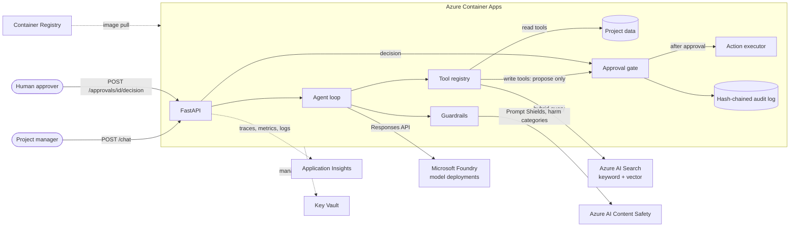
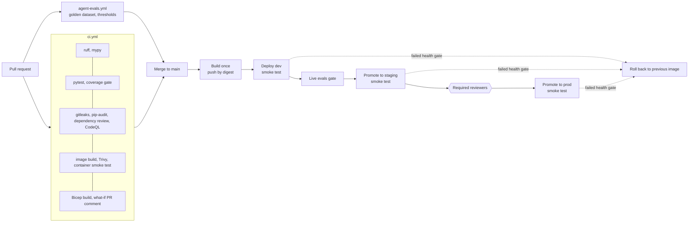

# Project Delivery Copilot: an Azure AI agent with full CI/CD

[](https://github.com/VCharrua/agentops-azure-project-copilot/actions/workflows/ci.yml)
[](https://github.com/VCharrua/agentops-azure-project-copilot/actions/workflows/agent-evals.yml)
[](LICENSE)

A reference implementation of an AI agent on Azure in which the delivery pipeline is the main
subject. The agent helps the project manager of a fictional construction company: it answers
questions over project documents, queries budget and schedule data through tools, flags risks,
drafts the weekly status report, and can propose write actions that run **only after a human
approves them**. Around it sit the things that decide whether an agent can be operated: build,
test, automated evaluation with quality gates, security scanning, infrastructure as code, and
promotion of one image through dev, staging and production with rollback.

> **Status, stated plainly.** Everything in this repository runs and is tested locally with mocked
> Azure services. The Azure paths (Bicep, the Azure adapters, the deployment workflows) compile,
> lint and are unit-tested against fakes, but have **not yet been validated on Azure**. Nothing here
> has been deployed. See [What is verified and what is not](#what-is-verified-and-what-is-not).
>
> All data is synthetic. "Alvora Construction", its clients, people and projects are invented, and
> this is not a client project.

## Architecture



Two channels, on purpose. The chat channel can only *propose* a write action. The approvals
channel is the only path to the executor, and it needs a named human. A prompt injection that gets
past every guardrail can therefore, at worst, create a proposal that a person reads and rejects.
More in [docs/architecture.md](docs/architecture.md).

## Pipeline



| Workflow | Trigger | What it does |
| --- | --- | --- |
| [`ci.yml`](.github/workflows/ci.yml) | PR, push to `main` | Lint, strict type-check, tests with an 85% coverage gate, secret scan, dependency audit, CodeQL, image build + Trivy + container smoke test, actionlint, Bicep build, Bicep what-if as a PR comment |
| [`agent-evals.yml`](.github/workflows/agent-evals.yml) | PR, push, nightly, manual | Runs the versioned golden dataset and fails below [`evals/thresholds.yaml`](evals/thresholds.yaml). Offline tier on every PR; live tier against dev |
| [`cd.yml`](.github/workflows/cd.yml) | push to `main` | Build once, then dev, live evals, staging, prod with the same digest. Smoke test after each deploy, rollback on failure |
| [`infra.yml`](.github/workflows/infra.yml) | manual | What-if, then optional Bicep deployment for one environment |
| [`teardown.yml`](.github/workflows/teardown.yml) | manual | Deletes and purges the dev environment to control cost |

Azure authentication is OIDC federation per GitHub Environment. There are no stored credentials,
and the Azure workflows stay inert until you connect a subscription, so a fresh fork has a green
pipeline.

## Quick start

### Local, no Azure account needed

Requires Python 3.12.

```bash
git clone https://github.com/VCharrua/agentops-azure-project-copilot.git
cd agentops-azure-project-copilot
python -m venv .venv && source .venv/bin/activate    # Windows: .venv\Scripts\activate
pip install -e ".[dev,azure]"

make lint     # ruff, mypy --strict, synthetic-data drift check
make test     # unit + integration tests, coverage gate
make eval     # golden dataset against the offline agent, threshold gate
make run      # API on http://localhost:8000/docs
```

No `make`? Each target is a one-line command; see the [Makefile](Makefile). A devcontainer is
included.

Try the human-in-the-loop flow:

```bash
# 1. Ask a grounded question (answer comes with citations)
curl -s localhost:8000/chat -H 'content-type: application/json' \
  -d '{"message": "Why was the level 9 slab pour delayed on the Riverside tower?"}'

# 2. Ask for a write action: it is proposed, not executed
curl -s localhost:8000/chat -H 'content-type: application/json' \
  -d '{"message": "Create a task for PRJ-002 to install pedestrian barriers at Gate B"}'

# 3. Approve it as a named human, on the separate approvals channel
curl -s localhost:8000/approvals/<action_id>/decision -H 'content-type: application/json' \
  -H 'X-Approver: your.name' -d '{"decision": "approve"}'

# 4. Read the tamper-evident audit trail
curl -s localhost:8000/audit
```

Or run the container: `make docker-build && make docker-run`.

### Deploy to Azure

The step-by-step guide is [docs/azure-setup.md](docs/azure-setup.md). In short:

```bash
az login && gh auth login
scripts/ci/bootstrap_oidc.sh <owner>/<repo>          # identities, federation, GitHub variables
gh workflow run infra.yml -f environment=dev -f action=deploy
gh variable set AZURE_DEPLOY_ENABLED --body true
gh workflow run cd.yml
```

Expect to fix things on the first run: this path has not been executed yet.

## Repository tour

```text
src/copilot/
  agent/          agent loop, model port, offline model, Foundry Responses adapter, prompt
  tools/          tool registry (schemas + validation), project data analytics, write executor
  retrieval/      Retriever port, local hybrid retriever, Azure AI Search adapter
  guardrails/     input / document / output screening, Content Safety adapter, PII redaction
  approvals/      approval gate and hash-chained audit log
  observability/  OpenTelemetry spans and metrics, PII-safe logging
  evals/          golden-dataset runner, metrics, attack simulations, optional LLM judge
  api/            FastAPI app (chat channel and approvals channel)
  bootstrap.py    composition root: picks mock or Azure adapters from configuration
tests/            unit, integration (HTTP, scripts), evals (golden dataset, mutation checks)
evals/            golden dataset (versioned JSONL) and thresholds
data/synthetic/   generated dataset; scripts/generate_synthetic_data.py reproduces it exactly
infra/            Bicep: main.bicep, one module per concern, dev/staging/prod parameter files
scripts/          data generator, smoke test, search indexing, agent registration, CI helpers
.github/          workflows, Dependabot, CODEOWNERS, PR template
docs/             architecture, ADRs, threat model, runbook, FinOps, responsible AI, setup
```

Why this shape: the agent depends on three ports (model, retriever, guardrail). Each has a
deterministic local adapter and an Azure adapter, and `bootstrap.py` is the only file that knows
which is in use. That is what lets a reviewer clone the repo and run everything, and what lets CI
gate every pull request without cloud credentials.

## Design decisions and trade-offs

| Decision | Why | Cost of the choice |
| --- | --- | --- |
| Approval gate enforced in code, not in the prompt ([ADR 0005](docs/adr/0005-approval-gate-in-code.md)) | The model is treated as untrusted. The loop never holds the executor | Two API channels; an approvals UI is still to be built |
| Agent definition ships in the image, sent inline over the Foundry Responses API ([ADR 0002](docs/adr/0002-foundry-responses-vs-managed-agent.md)) | Prompt and tools version, test and roll back together with the code | Less use of Foundry-managed agent features; registering a version in Agent Service is optional |
| Two evaluation tiers ([ADR 0003](docs/adr/0003-evaluation-strategy.md)) | Every PR gets a free, deterministic gate; model quality is measured where a real model exists | The offline tier does not measure reasoning quality |
| Build once, promote by digest across per-environment registries ([ADR 0006](docs/adr/0006-build-once-promote-by-digest.md)) | What was tested is what ships; prod has no runtime dependency on dev | An import step per promotion |
| Bicep over Terraform ([ADR 0001](docs/adr/0001-bicep-over-terraform.md)) | Azure-only scope, no state file to secure, native what-if | Not portable to other clouds |
| GitHub OIDC, identity per environment ([ADR 0004](docs/adr/0004-github-oidc.md)) | No long-lived credentials to leak or rotate | One-time federation setup |
| The container image is a Bicep parameter | One reviewable path for app and infrastructure changes; rollback is the same operation | Deployments take minutes, not seconds |

## Responsible AI and governance

- **Human oversight**: every write action needs an explicit decision by a named person; decisions
  are bound to the exact proposed arguments, single-use and time-limited.
- **Audit**: proposals, decisions, refusals and guardrail blocks go to a hash-chained log
  (`GET /audit` verifies the chain) and to Application Insights.
- **Least privilege**: one managed identity with data-plane roles only; key authentication is
  disabled on Foundry, AI Search, Content Safety and the registry.
- **Privacy**: prompts, answers and document content are never written to traces; logs and audit
  records pass through PII redaction.
- **Transparency**: every response carries an AI disclosure and citations to source documents.
- **Regulatory mapping**: [docs/responsible-ai.md](docs/responsible-ai.md) maps the design to EU AI
  Act and GDPR considerations. It is an engineering view, not legal advice.
- **Security**: [docs/threat-model.md](docs/threat-model.md) covers prompt injection, data
  exfiltration and tool abuse, with the gaps listed.
- **Cost**: SKU choices, the budget alert and the expected dev footprint are in
  [docs/finops.md](docs/finops.md).

## What is verified and what is not

| Area | State |
| --- | --- |
| Agent loop, tools, retrieval, guardrails, approval gate, audit log, API | Tested locally; `make test` passes with the coverage gate |
| Offline evaluation and its threshold gate | Runs locally and in a clean Linux container; mutation tests confirm the gate fails when guardrails or retrieval are removed |
| Container image | Built locally; the running container passes the smoke test as a non-root user |
| GitHub workflows | Pass `actionlint` (including shellcheck). **Not yet executed on GitHub** |
| Bicep | Compiles and lints with no warnings for all three environments. **Not yet validated on Azure** |
| Azure adapters (Foundry Responses, AI Search, Content Safety, Azure Monitor) | Unit-tested against fakes, built against the current SDKs. **Not yet validated on Azure** |
| Deployment, promotion, rollback, live evals, teardown, OIDC bootstrap | Written and linted. **Not yet validated on Azure** |

No benchmark or quality number for a real model appears in this repository, because none has
been measured.

## Limitations

- **The offline model is not a language model.** It is a rule-based planner that makes the system
  runnable and testable without a cloud. Offline eval scores measure the pipeline around the model
  (retrieval, guardrails, approval gate, tool plumbing). They are regression gates and say nothing
  about how a real model reasons.
- **Approval and session state are in memory.** Pending approvals are lost on restart or
  scale-to-zero, and the app must run as a single replica. The audit trail survives in Log
  Analytics, the local JSONL file does not.
- **Authentication is optional in the template.** Without `entraAuthClientId` the API is public
  and the approver header can be spoofed. That is acceptable only for a short-lived dev
  environment holding synthetic data.
- **No network isolation.** Services use public endpoints with Entra ID authentication; there are
  no private endpoints or VNet integration.
- **The local guardrail is heuristic** and the PII redaction is pattern-based. Both are a first
  layer and are easy to evade on their own.
- **Deployment identities are broad.** The template is subscription-scoped, so the pipeline
  identities hold Contributor and RBAC Administrator on the subscription.
- **Dependencies are range-pinned, not hash-locked.**
- **Budgets alert, they do not cap spend.**

## Roadmap

- Durable store for approvals and sessions (removes the single-replica constraint).
- A minimal approvals UI on top of the approvals API.
- Private endpoints and VNet integration; authentication on by default outside dev.
- Hash-locked dependencies and signed images with verification at deploy time.
- Canary rollout with traffic splitting between Container Apps revisions.
- A larger golden dataset with abstention ("the documents do not say") and multi-hop cases.
- Managed PII detection in front of telemetry.
- Resource-group-scoped deployment identities.

## What this demonstrates

- **Architecture judgment**: ports and adapters so the same code runs against mocks and Azure;
  safety properties placed in code paths that the model cannot reach.
- **DevOps maturity for AI systems**: evaluation as a merge gate, build-once promotion by digest,
  health-gated deployments with rollback, infrastructure previews on pull requests, keyless
  authentication end to end, pinned actions, cost teardown.
- **Responsible AI as engineering**: human oversight with an audit trail, tests that simulate a
  compromised model, PII-safe telemetry, and a written mapping to regulatory considerations.
- **Honesty about evidence**: a clear line between what was run and what was only written.

## Documentation

- [Architecture](docs/architecture.md) and [ADRs](docs/adr/)
- [Evaluation strategy](docs/evaluation.md)
- [Threat model](docs/threat-model.md)
- [Responsible AI: EU AI Act and GDPR considerations](docs/responsible-ai.md)
- [FinOps and cost notes](docs/finops.md)
- [Azure setup and first deployment](docs/azure-setup.md)
- [Runbook](docs/runbook.md)
- [Contributing, conventional commits and branch protection](CONTRIBUTING.md)

## License

[MIT](LICENSE)
