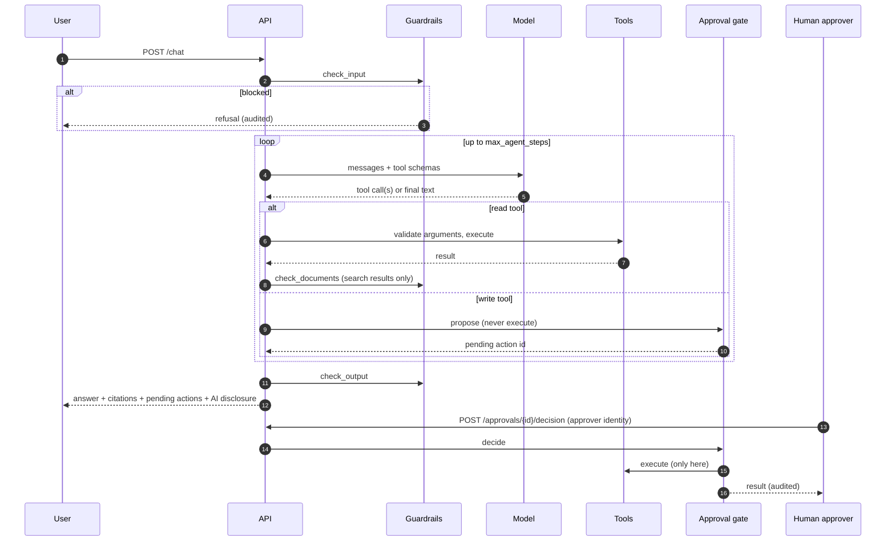

# Architecture

## Goals

1. An agent that is useful to a project manager: grounded answers, real numbers, routine drafts.
2. Write actions that cannot happen without a human decision, whatever the model does.
3. The same code running against mocks (laptop, CI) and against Azure, chosen by configuration.
4. Every change to code, prompt, tools or infrastructure passing through automated gates.

## Components

| Component | Responsibility | Local adapter | Azure adapter |
| --- | --- | --- | --- |
| API (`api/`) | Chat channel, approvals channel, audit endpoint | FastAPI | FastAPI on Container Apps |
| Agent loop (`agent/orchestrator.py`) | Guardrails, model turns, tool dispatch, step limit | same code | same code |
| Model port (`agent/model.py`) | "Given messages and tools, return text or tool calls" | `OfflineModel`, a rule-based planner | `FoundryResponsesModel`, Responses API on a Foundry project |
| Retriever port (`retrieval/base.py`) | Hybrid search over project documents | BM25 + hashing-trick vectors, fused with RRF | Azure AI Search, keyword + vector in one query |
| Guardrail port (`guardrails/base.py`) | Screen input, retrieved documents and output | Pattern heuristics | Heuristics, then Prompt Shields and harm categories |
| Tool registry (`tools/`) | Schemas, argument validation, read/write classification | same code | same code |
| Approval gate (`approvals/store.py`) | Hold proposals, apply human decisions, execute | in memory | in memory (see limitations) |
| Audit log (`approvals/audit.py`) | Append-only, hash-chained record | JSONL file | JSONL file + Application Insights |
| Telemetry (`observability/`) | Spans, metrics, PII-safe logs | no-op exporter | Azure Monitor OpenTelemetry distro |

`bootstrap.py` is the composition root and the only module that imports concrete adapters.

## Request flow

## The approval gate

The property the system must hold: **no write action executes without a decision from a named
human, made through the approvals API**. It is held by construction:

- The agent loop receives an `ApprovalGate` and calls only `propose`. It never receives the
  `ActionExecutor`. A unit test inspects the orchestrator for references to the executor and to
  `decide`.
- Write tools have no handler in the registry. There is nothing for the loop to call.
- `decide` requires a non-empty approver that is not a system name, checks the proposal is still
  pending and not expired, verifies the stored arguments still match the hash taken at proposal
  time, marks the action before executing so a concurrent decision cannot run it twice, and
  records the outcome in the audit log.
- Approval is not reachable from the chat channel. Saying "approved" in chat does nothing; a test
  covers it.
- The answer ends with a system-generated footer listing pending actions, so a model that claims
  "done" is contradicted in the same response.

Proposals carry risk flags for the approver, for example `suspicious_content_seen_in_session` when
a retrieved document was withheld as a suspected injection in the same run.

## Guardrails

Three checkpoints, each a port method:

1. **Input**: direct prompt injection and harmful requests. Blocked requests never reach the model.
2. **Retrieved documents**: indirect prompt injection. A flagged chunk removes its whole document
   from the results before the model sees them, and the user is told a document was withheld.
3. **Output**: harm categories on the final answer.

In Azure the local heuristics run first, then Azure AI Content Safety (Prompt Shields over REST,
harm categories through the SDK), both with Entra ID tokens. A Content Safety outage blocks by
default (`COPILOT_GUARDRAIL_FAIL_CLOSED`).

Guardrails reduce how often an attack reaches the model. They are not what keeps write actions
safe; the approval gate is. The evaluation suite checks both layers separately, including with
guardrails switched off.

## Data exfiltration control

`draft_email` only accepts recipients on an allow-list of internal domains
(`COPILOT_ALLOWED_EMAIL_DOMAINS`). A proposal to an outside address is refused before it becomes a
pending action, and the refusal is audited. Email drafts are saved, never sent.

## Observability

Spans: `agent.run` > `guardrail.input`, `agent.model_call`, `agent.tool_call`,
`guardrail.documents`, `guardrail.output`. Attributes follow the OpenTelemetry GenAI conventions
where one exists (`gen_ai.usage.input_tokens`, `gen_ai.usage.output_tokens`, `gen_ai.tool.name`).
Metrics: token usage, tool calls by outcome, guardrail blocks by stage.

Prompt text, answers and document content are never set as span attributes; a test asserts it.
Log records and audit records pass through PII redaction.

## Azure resources

| Resource | Purpose | Notes |
| --- | --- | --- |
| Container Apps environment + app | Hosts the API | Single-revision mode, probes on `/healthz`, logs through diagnostic settings |
| User-assigned managed identity | The app's only identity | Data-plane roles only |
| Container Registry (Basic) | Images, one registry per environment | Admin user disabled |
| Microsoft Foundry resource + project | Chat and embedding model deployments | Key authentication disabled |
| Azure AI Search (Basic) | Hybrid retrieval index | API keys disabled |
| Azure AI Content Safety | Prompt Shields, harm categories | Key authentication disabled |
| Key Vault | Application Insights connection string | RBAC authorization, secret reference from the app |
| Log Analytics + Application Insights | Traces, metrics, logs, audit copy | Retention and daily cap set |
| Consumption budget | Alerts at 80% actual and 100% forecast | Per resource group |

Role assignments for the app identity: AcrPull, Key Vault Secrets User, Foundry User, Search Index
Data Reader, Cognitive Services User, Monitoring Metrics Publisher.

## Known limitations

- Approval and session state are in memory: single replica, lost on restart. A durable store is
  the first roadmap item.
- Public endpoints with Entra ID authentication; no private networking.
- Platform authentication for the API is optional in the template and off by default in dev.
- In agent-bound mode (definition registered in Foundry Agent Service) the prompt no longer rolls
  back with the image.
- None of the Azure paths has been validated on Azure yet.
