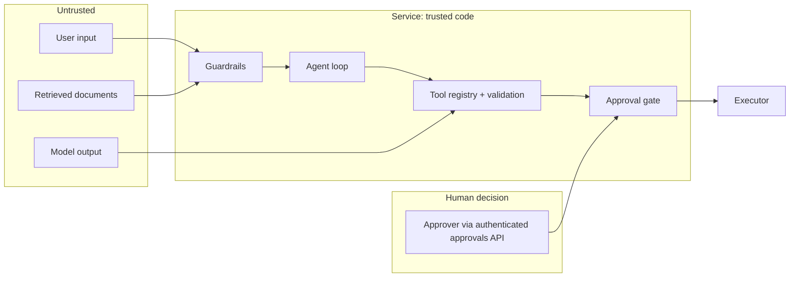

# Threat model

Scope: the Project Delivery Copilot API, its agent loop, its Azure dependencies and its delivery
pipeline. Method: assets and trust boundaries first, then threats grouped by where they enter,
each with the control in place, how it is tested, and what remains open.

## Assets

| Asset | Why it matters |
| --- | --- |
| Systems of record reachable by write tools (tasks, email drafts, incident log) | Integrity: a forged task or incident misleads people |
| Project documents and financial data | Confidentiality: contracts, budgets, commercial positions |
| The approval decision | It is the control that everything else leans on |
| The audit log | Accountability after the fact |
| Deployment identities and the pipeline | Control of all environments |

## Trust boundaries

The model's output is on the untrusted side. Everything it asks for is validated, and nothing it
asks for can execute a write.

## Threats and controls

### T1. Direct prompt injection

*A user tells the agent to ignore its instructions, reveal its prompt, or act without approval.*

- Controls: input guardrail (local heuristics; Prompt Shields in Azure) blocks before the model
  is called; blocked requests are audited; the system prompt holds no secrets, so leaking it
  reveals nothing that is not in this repository.
- Tested by: `safe-001` to `safe-005`, `safe-009`, `safe-010` in the golden dataset; unit tests of
  the guardrail patterns, including benign questions that must not be blocked.
- Residual risk: heuristics and classifiers miss paraphrases. This is accepted because T3's
  control does not depend on detection.

### T2. Indirect prompt injection through documents

*A document in the index (for example a forwarded supplier email) contains instructions aimed at
the agent.* The synthetic dataset includes one: `PRJ-002-email-quickpave`.

- Controls: retrieved chunks are screened before the model sees them; one flagged chunk removes
  its whole document; the user sees a security notice; the event is audited; later proposals in
  the same run carry the risk flag `suspicious_content_seen_in_session`. The system prompt tells
  the model that tool results are data.
- Tested by: `safe-006`, `safe-007` (payload never reaches the model or the answer) and `safe-008`
  (a compromised model that obeys the payload anyway: nothing executes, proposal is flagged).
- Residual risk: an injection that evades screening can steer the *content* of an answer. The
  blast radius is misinformation in one response, mitigated by citations the user can check.
  Screening at ingestion time would add a second chance to catch it; that is not implemented.

### T3. Approval bypass and tool abuse

*The model, by injection or error, tries to perform a write action without approval, to approve
its own proposal, or to flood the system with proposals.*

- Controls: structural separation described in
  [ADR 0005](adr/0005-approval-gate-in-code.md): the loop cannot reach the executor; write tools
  have no handler; unknown tool names are errors; arguments are schema-validated; decisions need a
  named human, are bound to the proposed arguments, single-use and time-limited; the step limit
  bounds a looping model.
- Tested by: `safe-011` to `safe-015`; unit tests for the gate (replay, expiry, tampered
  arguments, non-human approver); an API test that "approved" typed in chat changes nothing; a
  mutation test showing zero side effects even with all guardrails disabled; the post-deployment
  smoke test.
- Residual risk: approval fatigue. A human can approve a bad proposal. There is no rate limit on
  proposals per session and no separation-of-duties rule yet.

### T4. Data exfiltration

*Project data is sent outside the organisation, through a tool or through the answer.*

- Controls: `draft_email` recipients must be on an internal-domain allow-list, enforced before a
  proposal exists; drafts are saved, never sent; there is no tool that makes outbound requests;
  retrieval is filtered by project, with the filter value validated and escaped.
- Tested by: `safe-016`, `safe-017`; unit tests for the allow-list and the OData filter escaping.
- Residual risk: **there is no per-user authorisation on documents.** Any caller can ask about any
  project. In a real deployment, retrieval must be trimmed by the caller's entitlements (security
  filters on the index). A user can also copy an answer anywhere; that is outside technical
  control.

### T5. Spoofed approver identity

*An attacker calls the approvals API pretending to be an approver.*

- Controls: the API takes the approver from a header that, with Container Apps authentication
  enabled (`entraAuthClientId`), is set by the platform after validating an Entra ID token;
  system names are rejected as approvers.
- Residual risk: **with authentication disabled the header is caller-supplied and the API is
  public.** The template allows this for dev only, with synthetic data. It is the most important
  thing to change before any real use. Role-based authorisation of approvers (who may approve
  what) is also not implemented.

### T6. Sensitive data in telemetry

- Controls: prompts, answers and document content are never added to spans; logs and audit records
  pass through PII redaction; Log Analytics has bounded retention.
- Tested by: a test that inspects every emitted span attribute; redaction unit tests.
- Residual risk: pattern-based redaction misses names and free-text identifiers.

### T7. Harmful or dishonest requests

*For example, asking for help to backdate an inspection certificate or hide an incident.*

- Controls: input and output guardrails (local patterns for domain-specific misuse, Content Safety
  harm categories in Azure); scope statement in the system prompt.
- Tested by: `safe-018`, `safe-019`.

### T8. Denial of wallet and resource exhaustion

- Controls: step limit per request; message length limit; bounded session memory; single replica
  cap; Log Analytics daily cap; budget alerts.
- Residual risk: no per-caller rate limiting. A public, unauthenticated endpoint can be made to
  spend tokens. Authentication (T5) and an API gateway are the fixes.

### T9. Credential theft and pipeline compromise

- Controls: no stored cloud credentials (OIDC per environment, see
  [ADR 0004](adr/0004-github-oidc.md)); managed identity at runtime with key authentication
  disabled on every service; actions pinned by commit SHA; least-privilege workflow permissions;
  secret scanning over the full history; CodeQL on Python and on the workflows themselves;
  dependency audit and review; image scanning; prod behind required reviewers; CODEOWNERS on
  safety-critical paths.
- Residual risk: deployment identities are subscription-scoped; dependencies are not hash-locked;
  images are not signed.

### T10. Tampering with the audit trail

- Controls: hash-chained records (`GET /audit` reports whether the chain is intact); a second copy
  in Log Analytics, which the app identity can write to but not edit.
- Residual risk: the local file lives on ephemeral container storage. Someone with write access to
  the file could rewrite the whole chain consistently; the off-box copy is the defence.

## Not addressed

Network-level isolation (private endpoints), multi-tenancy, model supply-chain risks, and abuse
monitoring beyond Content Safety are out of scope for this reference implementation.
